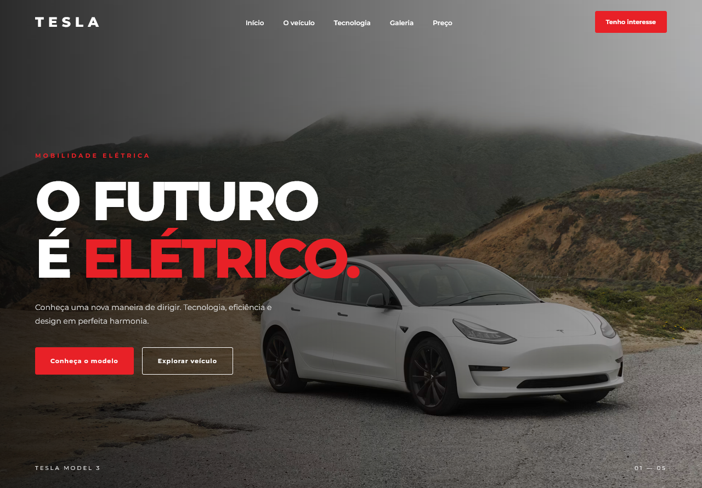

# Tesla Brazil - Landing Page

A modern and responsive landing page concept designed to showcase the Tesla Model 3 in the Brazilian automotive market.

This project was developed using pure HTML, CSS, and JavaScript, focusing on modern UI design, responsiveness, and front-end development practices.

> **Disclaimer:** This is an independent educational portfolio project. It is not affiliated with, endorsed by, or officially connected to Tesla, Inc. All commercial information and prices are fictional.

---

## Preview

<div align="center">

  

  <h3>Tesla Brazil - Landing Page</h3>

  <p>A modern automotive landing page built with HTML, CSS and JavaScript.</p>

</div>

### Main Features

- Responsive design for desktop, tablet, and mobile devices.
- Modern navigation menu with mobile support.
- Hero section with automotive imagery.
- Vehicle presentation and specifications.
- Technology showcase.
- Image gallery.
- Interactive financing simulator.
- Contact form with validation.
- WhatsApp contact integration.
- Scroll-based animations.
- Dynamic copyright year.

---

## Technologies

The project was developed using the following technologies:

| Technology | Purpose |
|---|---|
| HTML5 | Semantic page structure |
| CSS3 | Styling, layout, animations, and responsiveness |
| JavaScript | DOM manipulation and interactive features |
| Google Fonts | Typography |

No front-end frameworks or CSS libraries were used.

---

## Project Structure

```text
Tesla-Brazil-Landing-Page/
│
├── index.html
├── README.md
│
├── css/
│   └── style.css
│
├── js/
│   └── script.js
│
└── assets/
    └── images/
```

---

## Features in Detail

### 1. Responsive Interface

The layout adapts to different screen sizes, providing a consistent browsing experience across desktop, tablet, and mobile devices.

### 2. Financing Simulator

An interactive calculator that estimates monthly payments based on:

- Vehicle price.
- Down payment.
- Number of installments.
- Monthly interest rate.

The calculation uses a standard compound-interest installment formula.

All financing values are illustrative and do not represent an actual credit offer.

### 3. Contact Form

The contact form includes basic client-side validation for:

- Full name.
- Email address.
- Brazilian phone number.
- Optional message.

After validation, the visitor can send the information through WhatsApp.

No backend or database is implemented.

### 4. Scroll Animations

Elements become visible as the visitor navigates through the page, using the Intersection Observer API.

---

## Getting Started

### Requirements

- A modern web browser.
- A code editor such as Visual Studio Code.
- Internet connection for externally hosted images and Google Fonts.

### Installation

Clone the repository:

```bash
git clone https://github.com/Taunt-byte/Tesla-Brazil-Landing-Page.git
```

Navigate to the project directory:

```bash
cd Tesla-Brazil-Landing-Page
```

Open the project in Visual Studio Code:

```bash
code .
```

Run the project using the Live Server extension or open `index.html` directly in your browser.

---

## Configuration

### WhatsApp Integration

Open:

```text
js/script.js
```

Find the following configuration:

```javascript
const WHATSAPP_NUMBER = "5511999999999";
```

Replace it with your WhatsApp number, including the country code and area code.

Example:

```javascript
const WHATSAPP_NUMBER = "5511987654321";
```

---

## Customization

The vehicle price can be changed in `js/script.js`:

```javascript
const VEHICLE_PRICE = 299900;
```

The visual identity can be customized in:

```text
css/style.css
```

---

## Learning Objectives

This project was created to practice and improve front-end development skills, especially:

- Semantic HTML.
- CSS Grid and Flexbox.
- Responsive web design.
- JavaScript DOM manipulation.
- Event handling.
- Form validation.
- Mathematical calculations with JavaScript.
- Intersection Observer API.
- User interface design.

---

## Disclaimer

This website is an independent fictional project developed for educational and portfolio purposes.

Tesla, Model 3, and related trademarks belong to their respective owners.

The images are externally hosted and their availability and licensing should be verified before commercial use.

The displayed vehicle price and specifications are illustrative and must not be interpreted as official Tesla information or a real sales offer.

---

## Author

Developed as a front-end development portfolio project.

**Technologies:** HTML5 | CSS3 | JavaScript

**Repository:** Tesla-Brazil-Landing-Page
